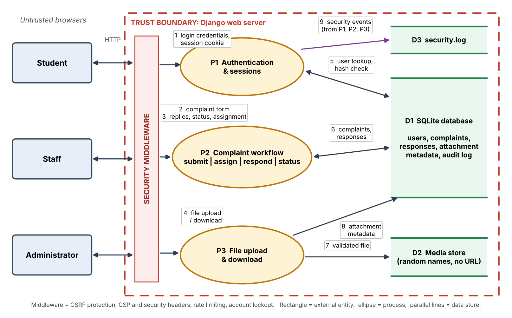
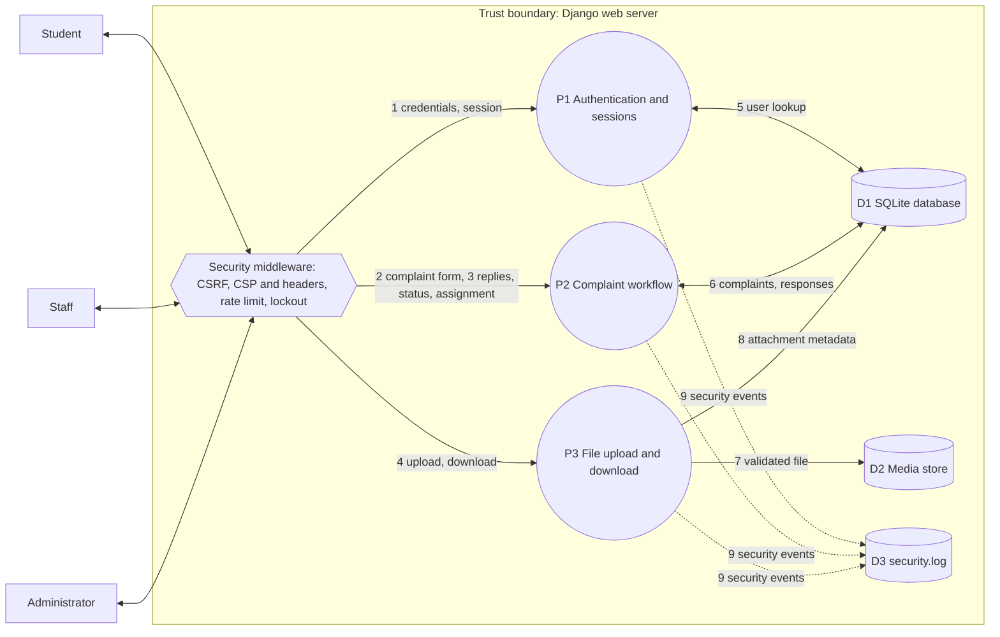

# Threat model: Student Complaints Portal

## 1. Scope, assets and attackers

**System:** Django web application with three roles (Student, Staff, Administrator), a SQLite
database, a protected media folder and a security log.

**Assets:** complaint text and evidence files, credentials, session tokens, audit-trail
integrity, availability.

**Attackers considered:** a curious or malicious student (horizontal and vertical privilege
escalation, malicious uploads); an external attacker (brute force, XSS, CSRF, injection);
an insider such as a staff member (repudiation, reaching beyond assigned cases).

**Trust boundaries:** (1) the browser is untrusted, everything it sends is validated on the
server; (2) between the Django application and its stores (database, media folder, log file).

## 2. Data flow diagram

The same diagram in Mermaid (rendered automatically by GitHub):

| Flow | Description |
|------|-------------|
| 1 | Login credentials and session cookie between users and P1 |
| 2 | Complaint form submitted by a student (with CSRF token) |
| 3 | Staff replies and status updates, administrator assignment |
| 4 | File upload (multipart) and authorised download |
| 5 | User lookup and password-hash verification (D1) |
| 6 | Complaints and responses read and written (D1) |
| 7 | Validated file stored under a random name (D2) |
| 8 | Attachment metadata (original name, size, content type) stored (D1) |
| 9 | Security events written to security.log and the audit log |

## 3. STRIDE analysis

| ID | STRIDE | Threat (flow) | Mitigation implemented | Evidence |
|----|--------|---------------|------------------------|----------|
| T1 | Spoofing | Attacker guesses or stuffs passwords to impersonate a student, staff member or administrator. (flow 1 (login)) | Argon2 (argon2id) password hashing, 10-character minimum plus common/numeric/similarity validators, django-axes lockout after 5 failures per username+IP, per-IP login rate limit (30 per 10 min), generic error message. | A07-6, A07-9, A07-10, A07-11; unit tests (lockout) |
| T2 | Spoofing | Session theft or fixation: attacker reuses or plants a session ID. (flow 1 (session)) | HttpOnly + SameSite=Lax cookies, Secure and HSTS when DEBUG=False, session ID rotated at login, 30-minute sliding expiry, session destroyed server-side at logout (POST only), no-store caching on private pages. | A07-3, A07-4, A07-7, A05-2 |
| T3 | Tampering | IDOR: a student edits the complaint or attachment ID in the URL to read another student's data. (flow 2, 4, 6) | All reads go through visible_complaints() (owner / assignee / admin filter). Foreign IDs return 404, so existence is not revealed. UUID primary keys. Denied attempts are logged. | A01-3, A01-4, A01-9, UP-7; unit tests (IDOR, audit) |
| T4 | Tampering | Mass assignment: forged form fields (role=admin, student=other user, status=resolved, assigned_to) to gain privileges or alter ownership. (flow 2, 6) | Forms list only safe fields. Registration forces role=student on the server. Owner, status and assignee are set by the server, never read from the POST. | A07-1; unit tests (registration, forged POST) |
| T5 | Tampering | CSRF: a malicious site makes a logged-in user's browser submit or change data. (flow 2, 3) | CsrfViewMiddleware on every POST, SameSite cookies, all actions POST-only, logout requires POST. | CSRF-1, CSRF-2, CSRF-3 |
| T6 | Tampering | SQL injection through the search box or status filter reads or destroys data. (flow 2, 6) | Django ORM only (parameterised queries, no raw SQL), allow-list for the status filter, input length caps. | A03-1, A03-2, A03-3; Bandit clean |
| T7 | Tampering | Stored or reflected XSS runs attacker script in a staff or admin browser. (flow 2, 3) | Template auto-escaping, no \|safe on user data, Content-Security-Policy script-src 'none', no inline scripts or styles, self-hosted assets. | A03-4, A03-5; unit test (no inline code) |
| T8 | Repudiation | A staff member or administrator denies an assignment, reply or status change, or an insider erases traces. (flow 3, 9) | Every security-relevant action writes an AuditLog row (user, action, IP, time) and a security.log line. AuditLog is read-only even for administrators in the admin site. User-supplied text is stripped of CR/LF to prevent log forging. | Unit tests: assignment, status change and upload are audited |
| T9 | Information disclosure | Uploaded evidence is read by someone else, or files are fetched directly by URL. (flow 4, 7) | Files stored outside any public URL under random names, served only by an authorised view (same access rule as the complaint) as attachments with nosniff and a sandbox CSP. | UP-6, UP-7, UP-8, A05-3 |
| T10 | Information disclosure | Secrets, stack traces or user lists leak through configuration or error pages. (flow 1, all) | SECRET_KEY and DEBUG from .env (git-ignored), DEBUG off by default, custom 403/404/429/500 pages, check --deploy clean apart from a deliberate HSTS-preload choice, identical login failure responses. | A05-3, A05-4, A07-6 |
| T11 | Denial of service | Flooding logins, complaint forms or uploads, or locking other users out. (flow 1, 2, 4) | Rate limits on login, registration, complaint, upload and staff actions (HTTP 429); 2 MB upload cap, 25-megapixel cap, 3 attachments per complaint; lockout scoped to username+IP so one attacker cannot block a whole network. | UP-4, A07-11 (found and fixed); rate-limit unit tests |
| T12 | Elevation of privilege | Malicious upload (web shell, polyglot, disguised executable, path traversal) executes on the server or in a victim's browser. (flow 4) | Extension allow-list, magic-byte check, Pillow image verification, random storage names, files never executed or served inline, nosniff and sandbox CSP on download. | UP-2, UP-3, UP-4, UP-5 |
| T13 | Elevation of privilege | Vertical escalation: a student calls staff or admin actions, or staff skip workflow rules. (flow 2, 3) | RoleRequiredMixin on every action view (403 and audit entry), object-level filtering after the role check, server-side status state machine so only legal transitions are accepted. | A01-5, A01-6, A01-7, A01-8, A01-10, A01-11, A01-12 |

Evidence IDs (A01-3, UP-2, ...) refer to the checks in `security_tests/attack_tests.py`; results
are in `docs/evidence/attack_results_before.md` and `attack_results_after.md`.
